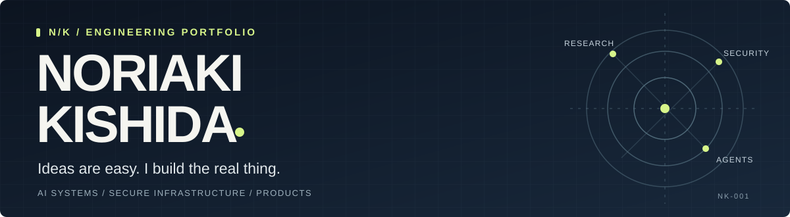

  

  <strong>Software Engineer · Computer Science & AI @ Minerva University '27 · San Francisco</strong>

  I build AI tools, reliable systems, and products people can use. 
  My work spans desktop apps, full-stack platforms, distributed systems, and secure AI infrastructure.

  <a href="https://noriakikishida.com">Portfolio ↗</a>
  &nbsp; • &nbsp;
  <a href="https://www.linkedin.com/in/noriaki-kishida/">LinkedIn ↗</a>
  &nbsp; • &nbsp;
  <a href="mailto:noriaki@uni.minerva.edu">Email ↗</a>

 

## 01 / Selected Work

### [knov](https://github.com/Marstronix218/knov)

**LOCAL-FIRST DESKTOP SOFTWARE · TECHNICAL ALPHA**

A macOS app that connects contracts, email, Slack, and work activity to surface unbilled work, missing invoices, and overdue commitments. A Rust core applies deterministic rules to source evidence; optional AI helps with context and clarification. Local storage, scoped connectors, and Keychain-held credentials keep privacy part of the architecture.

`Rust` `Tauri` `React` `TypeScript` `SQLite`

[Source code →](https://github.com/Marstronix218/knov) · [Case study →](https://noriakikishida.com/#case-study)

 

### [Veradact](https://github.com/Marstronix218/veradact)

**PRODUCT ENGINEERING · LIVE BETA**

A requirements sign-off product for software agencies: turn meeting notes into requirements clients can confirm, then give coding agents the agreed spec through MCP. Combines AI extraction, client review links, a versioned audit trail, and tenant isolation. Piloted with **12 users across four agencies**, confirming **110+ requirements**.

`Next.js` `TypeScript` `PostgreSQL` `Drizzle` `MCP` `Anthropic`

[Live product →](https://veradact.com) · [Source code →](https://github.com/Marstronix218/veradact)

 

### [Kafka in Python](https://github.com/Marstronix218/kafka-in-python)

**DISTRIBUTED SYSTEMS · PERSONAL PROJECT**

A Kafka-inspired replicated event log built to understand what survives a server failure. Implements partitioning, in-sync replication, leader failover, and idempotent producers. Testing recorded **zero lost acknowledged writes across 409,976 writes and 22 fault-injection runs**, with **2.2× throughput** from partitioning.

`Python` `HTTP/REST` `Docker Compose` `Replication` `Fault Injection`

[Source code →](https://github.com/Marstronix218/kafka-in-python)

 

### [Confidential LLM](https://github.com/Marstronix218/confidential-llm-on-nitro-enclaves)

**SECURE AI · OPEN-SOURCE REBUILD**

LLM inference inside an AWS Nitro Enclave, with an encrypted transport that keeps prompts and answers unreadable to the data-plane host. Separates the trusted control plane from the relay host and enclave, verifies attestation before key exchange, and includes a Docker Compose mock mode for running without AWS.

`Python` `AWS Nitro Enclaves` `Flask` `React` `Docker`

[Source code →](https://github.com/Marstronix218/confidential-llm-on-nitro-enclaves)

 

### [HookLoop](https://github.com/syang0624/hookloop)

**AI AGENTS · TEAM HACKATHON BUILD**

Three agents form creative hypotheses, generate ad reels, simulate campaign spend, and feed results into the next experiment. Combines structured model outputs, Thompson-sampling budget allocation, and a live reactive dashboard. **2nd Prize, Convex Track — YC Growth Hackathon 2026.**

`Next.js` `Convex` `OpenAI` `Sora`

[Live demo →](https://hookloop-ruddy.vercel.app) · [Source code →](https://github.com/syang0624/hookloop)

 

### [IndoBiz Japan](https://github.com/Marstronix218/indobiz_japan)

**PRODUCTION PLATFORM · GLOBAL LAUNCHERS INC.**

An India business-news platform for Japanese executives, built and deployed end to end. Ingests **500+ articles a day from 45+ RSS feeds**, deduplicates and synthesizes stories, and checks summaries against source evidence before publishing. Includes membership payments, authentication, and publishing tools.

`Next.js` `TypeScript` `Python` `Supabase` `Claude` `Stripe`

[Live site →](https://indobiz-japan.launchers-g.com/) · [Source code →](https://github.com/Marstronix218/indobiz_japan)

 

**Also built**

- **[idobataAI](https://github.com/Marstronix218/idobataAI)** — A productivity network with private tasks, opt-in sharing, human conversations, and labelled AI personas. [Live site ↗](https://idobata-ai.com)
- **[Research Copilot](https://github.com/Marstronix218/Research-Copilot)** — A Chrome extension that turns research goals into questions, tracks relevant insights, and identifies knowledge gaps.
- **[SOLID Marketplace](https://github.com/syang0624/fb_stripe_marketplace)** — A team-built buying agent with listing analysis, simulated negotiations, and meetup payment confirmation. **3rd Place, Auth0 × Stripe Hackathon.**

 

## 02 / Experience

I've worked with teams across Japan, South Korea, and Taiwan, taking projects from architecture through deployment.

- **Piece.ai · Software Engineer Intern, AI Agents & Backend** — Added per-branch frontend previews and restored organization-wide CI for an enterprise AI-agent platform.
- **Global Launchers · Tech Lead / CTO** — Built IndoBiz Japan and automated news curation and distribution, eliminating **10 hours of manual curation a week**.
- **EAGLYS · Software Engineer Intern, AI Infrastructure** — Built confidential inference infrastructure and a control plane that cut environment setup from **60 to 5 minutes**.
- **GSP Cloud · Software Engineer Intern, Full-Stack** — Built a console and APIs managing **50+ AI-agent workflows**.
- **BearVFX · Software Engineer Intern, AI Applications** — Built a pipeline from topic to narrated, lip-synced educational video, cutting production from **4 hours to 8 minutes** in testing.

 

## 03 / Tools I Use

| Area | Tools |
| :--- | :--- |
| Languages | Python, TypeScript, JavaScript, Rust, SQL |
| Products & interfaces | React, Next.js, Tauri, FastAPI, Flask, Node.js |
| AI & automation | OpenAI, Anthropic, PyTorch, MCP, n8n |
| Systems & infrastructure | AWS, Docker, Linux, PostgreSQL, Supabase, GitHub Actions |

 

## 04 / Selected Recognition

| Year | Recognition |
| :--- | :--- |
| 2026 | Audience Favorite — AI Supply Chain Hackathon, RxKitchen |
| 2026 | 3rd Place — Auth0 × Stripe Hackathon, SOLID Marketplace |
| 2026 | 2nd Prize, Convex Track — YC Growth Hackathon, HookLoop |
| 2025 | Winner — Students@AI Seoul Hackathon, 200 teams |
| 2024 | Winner — Minerva Hiring Hackathon, 150 teams |

 

## 05 / Contributions in Motion

  <picture>
    <source media="(prefers-color-scheme: dark)" srcset="https://raw.githubusercontent.com/Marstronix218/Marstronix218/output/github-snake-dark.svg">
    <source media="(prefers-color-scheme: light)" srcset="https://raw.githubusercontent.com/Marstronix218/Marstronix218/output/github-snake.svg">
    
  </picture>
   
  Generated daily from my GitHub contributions with <a href="https://github.com/Platane/snk">snk</a>.

 

---

  Studying Computer Science & AI at Minerva University, graduating May 2027. 
  Always interested in useful products, thoughtful engineering, and people building both.
    
  <a href="https://noriakikishida.com"><b>Explore my work ↗</b></a>
  &nbsp; • &nbsp;
  <a href="mailto:noriaki@uni.minerva.edu"><b>Get in touch ↗</b></a>

